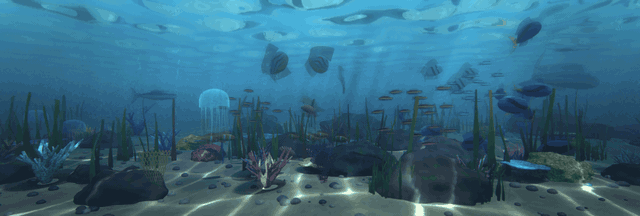

# Aquarium Screensaver

[English](README.md) · **Español**

Un protector de pantalla de acuario 3D en tiempo real para Windows, escrito en Python con OpenGL. Cada pez, coral y roca se genera con código (sin archivos de modelos ni texturas), los cardúmenes nadan en un único mundo continuo por todos tus monitores, la iluminación sigue tu reloj, y las sombras, la oclusión ambiental, las cáusticas, los haces de luz, los reflejos y las refracciones se trazan con rayos.

**Web y guía de instalación:** https://madkoding.github.io/aquarium-screensaver/es/



*Clip de demostración en bucle del protector en funcionamiento.*


*Captura real de una configuración de 3 monitores (un ultrapanorámico central y dos pantallas verticales).*

| Peces: aletas translúcidas, escamas, lente de medusa | El fondo marino: coral, abanicos de mar, guijarros, algas |
|---|---|
|  |  |

| La superficie del agua, vista desde abajo | De noche |
|---|---|
|  |  |

## Características

**Peces y comportamiento**
- **Peces 3D totalmente procedurales:** una malla paramétrica (cuerpo torneado con cabeza modelada y ojos saltones, cola bifurcada, aletas dorsal, anal, pélvicas y pectorales) animada en el vertex shader con una onda que viaja de la cabeza a la cola. Las especies solo se diferencian por parámetros: proporciones, tamaño de aletas, colores y patrón de piel.
- **Ocho especies:** tetras neón, peces payaso, cirujanos azules, escalares, discos, peces león, atún y un tiburón ocasional que patrulla el agua lejana. Todos los demás huyen cuando el tiburón se acerca.
- **Cardúmenes:** cada cardumen sigue un punto de ruta errante y sus miembros aplican las reglas de *boids* (cohesión, alineación, separación) con límites suaves del tanque.
- **Piel detallada:** escamas individuales que se solapan (se desvanecen con la distancia en lugar de parpadear), línea lateral punteada, opérculos, dibujos con bordes ondulados y orgánicos, aletas translúcidas con nervaduras que se bifurcan y bordes irregulares que brillan cuando el sol las atraviesa, dispersión subsuperficial en los bordes finos, iridiscencia de película delgada cuyo tono cambia con el ángulo de visión y deriva lentamente con el tiempo (se desactiva con el ajuste `iridescence`), reflejos del entorno sobre la piel húmeda y ojos brillantes con iris radial y cristalino abombado.

**El arrecife**
- **Fondo marino procedural:** rocas en capas con bandas minerales, grietas, percebes y musgo, arena con grano y ondulaciones, cientos de guijarros, corales cerebro con surcos que serpentean, corales ramificados (cuerno de ciervo) con pólipos y anillos de crecimiento, corales de mesa, abanicos de mar con celosía, anémonas con tentáculos redondos de punta pálida, pasto marino y algas con nervadura central y venas que la luz atraviesa, bosques de algas que proyectan sombras suaves, medusas translúcidas que laten (borde festoneado, canales radiales, gónadas y brazos orales con volantes), chorros de burbujas y nieve marina a la deriva que brilla dentro de los haces de luz.

**Iluminación con trazado de rayos (híbrida)** — la escena se rasteriza y estos efectos se trazan por píxel en shaders (no hacen falta núcleos RT, así que funciona en cualquier GPU con OpenGL 3.3):
- **Sombras suaves** de peces, medusas, rocas, coral y algas, con rayos de sombra contra oclusores elipsoidales y una rejilla en el espacio del sol como estructura de aceleración.
- **Oclusión ambiental:** un rayo aleatorio del hemisferio por píxel y fotograma, promediado en el tiempo.
- **Luz rebotada:** la arena iluminada por el sol ilumina la parte inferior de rocas, corales y peces.
- **Luz indirecta con una rejilla de sondas de irradiancia:** 38x6x30 sondas, cada una con un cubo ambiental que se refresca en cada fotograma con dos rayos por dirección contra los oclusores y el fondo, y se promedia en el tiempo. Las superficies la leen con interpolación trilineal y solo se aplica la diferencia respecto al agua abierta, así que el agua abierta no cambia, mientras que el lado a sotavento de las rocas se oscurece y el coral tiñe a los peces cercanos (`gi`).
- **Cáusticas físicas:** los rayos del sol se refractan (ley de Snell) a través de una superficie de agua animada y se concentran sobre la arena.
- **Haces de luz volumétricos** que recogen las cáusticas y las sombras de peces y rocas.
- **La superficie del agua vista desde abajo:** la reflexión total interna refleja el fondo, las rocas y los peces, y la ventana de Snell muestra el cielo cuando miras muy hacia arriba.
- **Refracción:** las medusas actúan como lentes de gel y cada burbuja es una pequeña lente con dispersión cromática.

**Cámara e imagen**
- **Profundidad de campo** (con un enfoque que «respira» lentamente), aberración cromática y grano de película sutiles, bloom, viñeteado, MSAA, antialiasing temporal y dither contra el banding.
- **Escalado AMD FSR 1.0** (activado por defecto en *quality*): un port a GLSL de EASU + RCAS de AMD que renderiza menos píxeles y los escala, lo que paga todos los efectos anteriores. Hay un escalador temporal experimental disponible como `upscaler: "temporal"`.
- **Aspecto fotográfico** (`realism`, 0,7 por defecto): curva de tono de película, ligera desaturación con sombras frías y luces cálidas, y agua más turbia que absorbe el rojo más rápido.
- Iluminación de día, atardecer y noche que sigue tu reloj (de noche los tetras neón brillan).

**Sistema**
- **Un mundo continuo:** una sola cámara en perspectiva cubre todo el escritorio virtual, así que los peces nadan de un monitor al siguiente. Funcionan tamaños y orientaciones mezclados.
- **Ventana de ajustes** y **vista previa** en vivo en el selector de protectores de pantalla de Windows.
- **Sincronizado con tus pantallas:** los fotogramas se limitan a la frecuencia del monitor más rápido (60, 75, 144 Hz...) y bajan a 30 FPS con batería. La conexión y desconexión de pantallas se detecta automáticamente.
- Se cierra con cualquier tecla, clic o movimiento del ratón.

## Descarga

Descarga `Aquarium.scr` desde la [última versión](../../releases/latest), haz clic derecho sobre el archivo y elige **Instalar**. Windows abre el selector de protectores de pantalla con él ya seleccionado; usa **Configuración...** ahí para ajustar la escena.

> El archivo no está firmado digitalmente (hace falta un certificado de pago), así que Windows SmartScreen o un antivirus pueden avisar, algo habitual en los ejecutables de PyInstaller. Puedes revisar el código fuente aquí y compilarlo tú mismo.

Requiere una GPU con **OpenGL 3.3** o superior. Si tu GPU va justa, sube `upscaling` a `balanced` o `performance`, o baja `quality`.

## Ajustes

Abre **Configuración...** en el selector de protectores de pantalla. Los valores se guardan en `%APPDATA%\AquariumScreensaver\settings.json`.

| Ajuste | Qué hace |
|---|---|
| `water` | Color del agua: tropical, deep, lagoon, aegean. |
| `light` | `auto` (sigue tu reloj), `day`, `dusk` o `night`. |
| `quality` | `low` (sin MSAA, 75 % de resolución), `medium` (MSAA 2x), `high` (MSAA 4x). |
| `upscaling` | AMD FSR 1.0: `off`, `quality` (1,5x, por defecto), `balanced` (1,7x) o `performance` (2x). |
| `upscaler` | `fsr1` (por defecto, AMD FSR 1.0 espacial) o `temporal` (experimental: fotogramas con jitter, vectores de movimiento e historial acumulado). Medido contra una referencia nativa con MSAA, solo empata con FSR 1 a 2x y pierde a 1,5x. |
| `sharpness` | Afilado de FSR en pasos (stops): 0 es lo más nítido, 2 lo más suave (el valor de AMD es 0,2). |
| `realism` | De 0 a 1: aspecto fotográfico (curva de película, colorimetría, agua más turbia). |
| `gi` | De 0 a 1: intensidad de la luz indirecta de la rejilla de sondas (requiere `raytracing`). |
| `fish` / `fish_scale` | Cantidad de peces (5 a 200) y un multiplicador de tamaño. |
| `jellyfish` | Cantidad de medusas (0 a 8). |
| `shark` | Permite que un tiburón ocasional patrulle el agua lejana. |
| `bubbles` | Chorros de burbujas. |
| `raytracing` | Sombras trazadas por rayos, oclusión ambiental, cáusticas, haces de luz, espejo del agua y refracción. Desactívalo para un aspecto procedural más barato. |
| `taa` | Antialiasing temporal (también suaviza la AO trazada y los haces de luz). |
| `dof` | Intensidad de la profundidad de campo, de 0 a 1. |
| `lens` | Aberración cromática y grano de película, de 0 a 1. |
| `bloom` / `vignette` | Intensidad del brillo y oscurecimiento de las esquinas. |
| `camera_drift` | Balanceo lento y sutil de la cámara. |

## Rendimiento

Medido sin tope de FPS en una RTX 3060 con tres monitores (5240x1772, 9,3 millones de píxeles), con los ajustes por defecto salvo lo indicado:

| Configuración | FPS |
|---|---|
| Por defecto (`quality` MSAA 2x, FSR quality, trazado de rayos activado) | unos 93 |
| FSR performance | unos 125 |
| FSR desactivado (resolución nativa) | unos 59 |
| Trazado de rayos desactivado | unos 155 |

Con los valores por defecto se mantiene sin problema un tope de 75 Hz.

## Pruebas

El conjunto de pruebas se ejecuta con el `python3` que se encuentre en `PATH` (Python 3.10+ con `numpy` y `pygame-ce` instalados). Ejecútalo desde la raíz del proyecto:

```sh
python3 -m compileall -q . && python3 -m unittest discover -p "test_*.py" -v
```

Las pruebas de cableado usan dobles de grabación en lugar de un contexto de OpenGL, así que no demuestran que los shaders compilen ni que la salida se vea bien en pantalla.

## Compilar desde el código

Requiere Windows y Python 3.10+.

```powershell
python -m pip install -r requirements.txt pyinstaller
.\build.ps1
```

Esto genera `Aquarium.scr`. Subir una etiqueta `v*` ejecuta el workflow de GitHub Actions de `.github/workflows/release.yml`, que lo compila y lo adjunta al release.

### Ejecutar directamente con Python

```powershell
python aquarium_saver.py /s
```

Opciones de desarrollo:

| Opción | Efecto |
|---|---|
| `--seconds N` | Sale tras N segundos e ignora la entrada. |
| `--shot ARCHIVO` | Guarda una captura justo antes de salir. |
| `--at SEGUNDOS` | Pre-simula este tiempo para que los cardúmenes ya estén repartidos (para capturas). |

Ejemplo: `python aquarium_saver.py /s --seconds 6 --at 25 --shot captura.png`

> Notas: lanzar un `.scr` con `Start-Process` o doble clic hace que Windows añada `/S` y descarte tus argumentos, así que ejecútalo directamente desde una terminal. Git Bash convierte `/p` en una ruta de unidad; ahí usa `MSYS_NO_PATHCONV=1`.

## Cómo funciona

| Archivo | Función |
|---|---|
| `aquarium_saver.py` | Punto de entrada: análisis de argumentos (`/s`, `/c`, `/p`), bucle principal, sincronización de fotogramas, detección de monitores conectados y de batería. |
| `renderer.py` | Pipeline OpenGL: cáusticas, espejo, actualización de sondas, escena (MSAA), velocidad, copia para refracción, volumen, TAA, profundidad de campo, bloom, composición final y escalado. |
| `shaders.py` | Todo el GLSL: animación y piel de los peces, materiales, rayos de sombra, AO, trazado de cáusticas, pases de espejo y volumen, refracción, TAA, profundidad de campo. |
| `meshes.py` | Geometría procedural: peces, algas y pasto marino, rocas, guijarros, corales, abanicos de mar, anémonas, fondo marino, medusas. |
| `sim.py` | Tabla de especies, cardúmenes con *boids*, patrulla del tiburón y huida, movimiento de las medusas. |
| `rt.py` | Datos del trazado de rayos: textura de oclusores elipsoidales, rejilla de sombras en el espacio del sol, rejilla de AO en el espacio del mundo, disposición del mapa de cáusticas. |
| `fsr.py` | AMD FSR 1.0 (EASU + RCAS) autónomo y reutilizable para moderngl: `FSR(ctx).upscale(src_tex, src_size, dst_fbo, dst_size, sharpness)`, más `sharpen(...)` para solo RCAS. |
| `taau.py` | Escalador temporal experimental: fotograma de baja resolución con jitter + buffer de velocidad + historial a resolución final. |
| `world.py` | Cámara, proyección y la función de altura del fondo marino compartida entre la CPU y los shaders. |
| `settings.py` / `config_dialog.py` | Valores por defecto, persistencia JSON y la ventana de ajustes en Tk. |
| `winapi.py` | Monitores con DPI por pantalla, frecuencia de refresco, estado de energía, instancia única, incrustación de la vista previa. |

- Un `.scr` es solo un `.exe` renombrado; Windows lo lanza con `/s` (ejecutar), `/c` (configurar) o `/p HWND` (vista previa). [PyInstaller](https://pyinstaller.org) empaqueta el script.
- Los peces se dibujan con llamadas instanciadas: un pase opaco para el cuerpo y un segundo pase con mezcla alfa para las aletas. El vertex shader escala las aletas desde su base, mueve las pectorales y curva la columna con una onda de la cabeza a la cola.
- **Rayos de sombra:** los oclusores viven en una textura flotante. Proyectar cada punto a lo largo de la dirección de la luz sobre un plano hace que todos los puntos de un mismo rayo de sol caigan en la misma celda de la rejilla, así que cada rayo de sombra solo prueba los pocos elipsoides de su celda, tras un descarte rápido con esfera envolvente.
- **Oclusión ambiental:** un rayo con distribución coseno por píxel y fotograma contra una rejilla en el espacio del mundo; el rayo es más corto que una celda, así que solo visita dos. El TAA promedia los fotogramas.
- **Cáusticas:** una malla densa sobre la superficie del agua refracta un rayo de sol por vértice hasta el fondo. El vertex shader calcula el jacobiano de esa transformación superficie-fondo; su inverso es la energía por área, acumulada de forma aditiva en una textura que muestrean el suelo, las algas, los peces y los haces de luz.
- **TAA con un pase de velocidad para los peces:** jitter subpíxel, reproyección de cámara a partir de la distancia guardada en el canal alfa de la escena (que también usan los pases de volumen y de profundidad de campo), un pase aparte que dibuja los peces con la pose del fotograma anterior y guarda dónde estaba cada píxel en pantalla, y un límite por varianza que rechaza los fantasmas restantes.
- **Nitidez:** el mapa de cáusticas es de 2560x1200 (unos 2,5 cm por texel) alimentado por una malla de 0,09, las consultas usan un ligero desenfoque de mip para que las líneas finas de foco sigan suaves de cerca, y el espejo de la superficie del agua se traza a menor resolución con ondas filtradas por distancia para que no haga aliasing.
- La simulación cuesta unos 2 ms por fotograma con 60 peces; todo lo demás se ejecuta en la GPU.

## Requisitos

- Windows 10/11 con una GPU compatible con OpenGL 3.3
- Python 3.10+, `pygame-ce`, `numpy`, `moderngl` (solo para ejecutarlo desde el código)

## Licencia

Copyright (C) 2026 madkoding. Este proyecto es software libre, publicado bajo la [Licencia Pública General de GNU v3.0](LICENSE): puedes usarlo, estudiarlo, compartirlo y modificarlo, y redistribuir versiones modificadas bajo la misma licencia. Los componentes de terceros conservan sus propias licencias; consulta [THIRD_PARTY_NOTICES.md](THIRD_PARTY_NOTICES.md).

## Créditos

- El escalado se basa en AMD FidelityFX Super Resolution 1.0 (licencia MIT); consulta [THIRD_PARTY_NOTICES.md](THIRD_PARTY_NOTICES.md).
