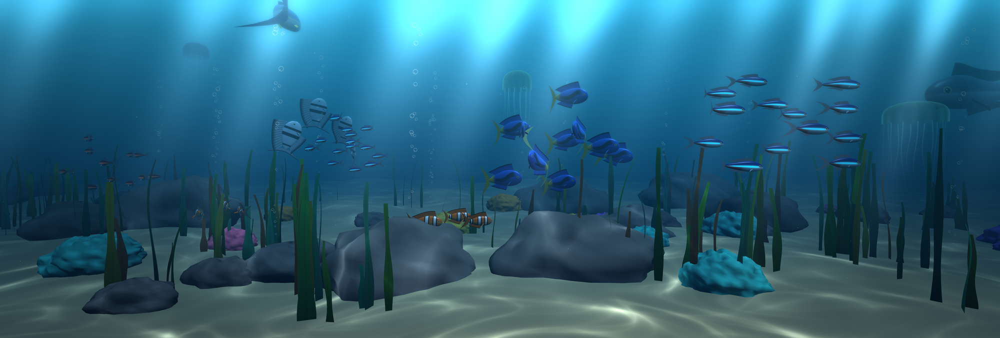
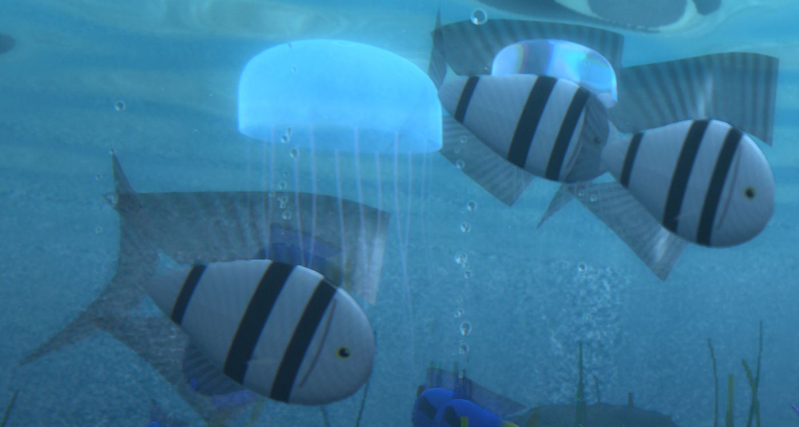
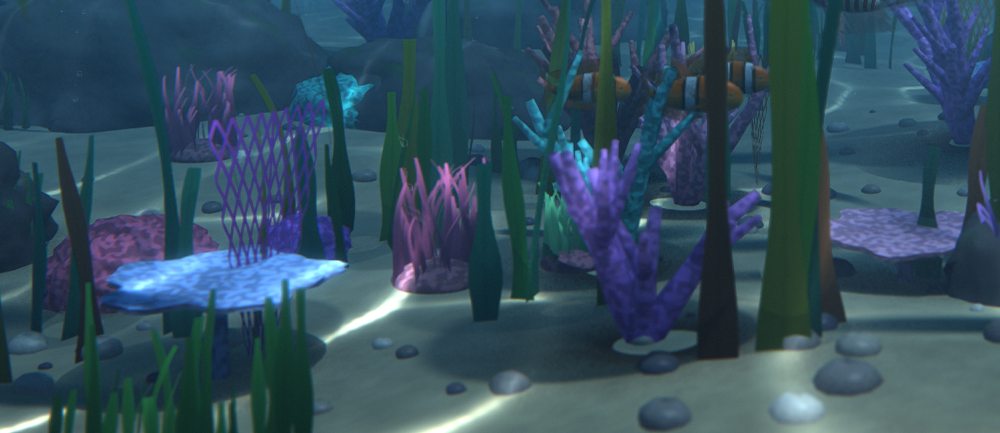
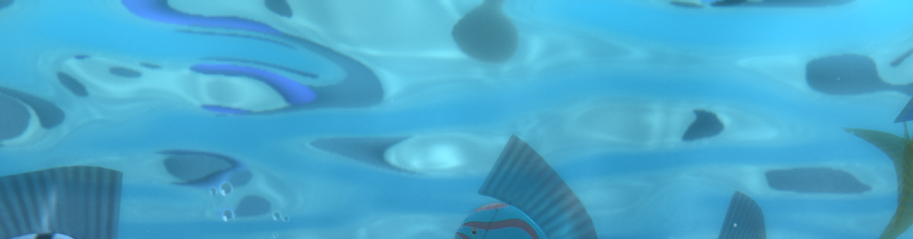
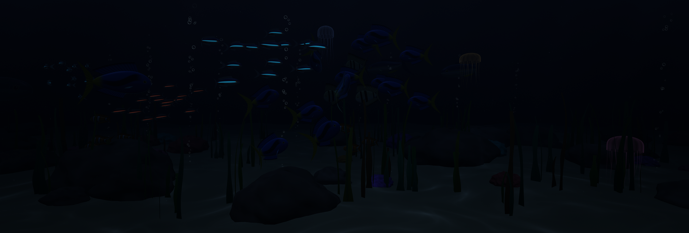

# Aquarium Screensaver

A real-time 3D aquarium screensaver for Windows, written in Python with OpenGL. Every fish, coral and rock is generated from code (no model or texture files), schools swim as one continuous world across all your monitors, the lighting follows your clock, and shadows, ambient occlusion, caustics, light shafts, reflections and refractions are ray traced.

**Website and install guide:** https://madkoding.github.io/aquarium-screensaver/



*Real capture from a 3-monitor setup (a central ultrawide plus two portrait displays).*

| Fish: translucent fins, scales, jellyfish lens | The seabed: coral, sea fans, pebbles, kelp |
|---|---|
|  |  |

| The water surface, seen from below | At night |
|---|---|
|  |  |

## Features

**Fish and behavior**
- **Fully procedural 3D fish:** one parametric mesh (lofted body, forked tail, dorsal, anal and pectoral fins) animated in the vertex shader with a wave that travels from head to tail. Species differ only by parameters: proportions, fin sizes, colors and skin pattern.
- **Eight species:** neon tetras, clownfish, blue tangs, angelfish, discus, lionfish, tuna, and an occasional shark patrolling the far water. Everyone else flees when the shark gets close.
- **Schooling:** every school follows a roaming waypoint and its members apply boid rules (cohesion, alignment, separation) with soft tank bounds.
- **Detailed skin:** translucent fins with rays that glow when the sun shines through them, bump-mapped scales, subsurface scattering on thin edges, thin-film iridescence, gills, mouths and glossy wet eyes.

**The reef**
- **Procedural seabed:** layered rocks with moss and cracks, sand with grain and ripples, hundreds of pebbles, branching (staghorn) and table corals, lattice sea fans, anemones with glowing tentacles, seagrass, kelp forests that cast soft shadows, translucent pulsing jellyfish, bubble streams and drifting marine snow that sparkles inside the light shafts.

**Ray-traced lighting (hybrid)** — the scene is rasterized and these effects are traced per pixel in shaders (no RT cores needed, so it runs on any OpenGL 3.3 GPU):
- **Soft shadows** from fish, jellyfish, rocks, coral and kelp, using shadow rays against ellipsoid occluders and a sun-space grid as the acceleration structure.
- **Ambient occlusion:** one random hemisphere ray per pixel per frame, averaged over time.
- **Bounced light:** the sunlit sand lights the undersides of rocks, coral and fish.
- **Physical caustics:** sun rays are refracted (Snell's law) through an animated water surface and focused onto the sand.
- **Volumetric light shafts** that pick up the caustics and the shadows of fish and rocks.
- **The water surface seen from below:** total internal reflection mirrors the sea floor, rocks and fish, with Snell's window showing the sky when you look steeply up.
- **Refraction:** jellyfish act as gel lenses and every bubble is a tiny lens with chromatic dispersion.

**Camera and image**
- **Depth of field** (with slow focus breathing), subtle chromatic aberration and film grain, bloom, vignette, MSAA, temporal anti-aliasing and de-banding dither.
- **AMD FSR 1.0 upscaling** (on by default at *quality*): a GLSL port of AMD's EASU + RCAS that renders at fewer pixels and upscales, which pays for all the effects above.
- Day, dusk and night lighting that follows your clock (at night the neon tetras glow).

**System**
- **One continuous world:** a single perspective camera covers the whole virtual desktop, so fish swim from one monitor to the next. Mixed sizes and orientations work.
- **Settings dialog** and a live **preview** in the Windows screensaver picker.
- **Paced to your displays:** frames are capped at the fastest monitor's refresh rate (60, 75, 144 Hz...) and drop to 30 FPS on battery. Display hot-plugging is detected automatically.
- Exits on any key press, click, or mouse movement.

## Download

Grab `Aquarium.scr` from the [latest release](../../releases/latest), then right-click it and choose **Install**. Windows opens the screensaver picker with it already selected; use **Settings...** there to tweak the scene.

> The file is not code-signed (that needs a paid certificate), so Windows SmartScreen or an antivirus may warn about it, as is common with PyInstaller executables. You can inspect the source here and build it yourself.

Requires a GPU with **OpenGL 3.3** or newer. If your GPU struggles, raise `upscaling` to `balanced` or `performance`, or lower `quality`.

## Settings

Open **Settings...** in the screensaver picker. Values are stored in `%APPDATA%\AquariumScreensaver\settings.json`.

| Setting | What it does |
|---|---|
| `water` | Water color: tropical, deep, lagoon, aegean. |
| `light` | `auto` (follows your clock), `day`, `dusk` or `night`. |
| `quality` | `low` (no MSAA, 75% resolution), `medium` (2x MSAA), `high` (4x MSAA). |
| `upscaling` | AMD FSR 1.0: `off`, `quality` (1.5x, default), `balanced` (1.7x) or `performance` (2x). |
| `sharpness` | FSR sharpening in stops: 0 is sharpest, 2 softest (AMD's default is 0.2). |
| `fish` / `fish_scale` | Number of fish (5 to 200) and a size multiplier. |
| `jellyfish` | Number of jellyfish (0 to 8). |
| `shark` | Let an occasional shark patrol the far water. |
| `bubbles` | Bubble streams. |
| `raytracing` | Ray-traced shadows, ambient occlusion, caustics, light shafts, water mirror and refraction. Turn it off for the cheaper procedural look. |
| `taa` | Temporal anti-aliasing (also smooths the traced AO and light shafts). |
| `dof` | Depth of field strength, 0 to 1. |
| `lens` | Chromatic aberration and film grain, 0 to 1. |
| `bloom` / `vignette` | Glow strength and corner darkening. |
| `camera_drift` | Slow, subtle camera sway. |

## Performance

Measured uncapped on an RTX 3060 across three monitors (5240x1772, 9.3 million pixels), default settings except where noted:

| Configuration | FPS |
|---|---|
| Default (`quality` 2x MSAA, FSR quality, ray tracing on) | about 93 |
| FSR performance | about 125 |
| FSR off (native resolution) | about 59 |
| Ray tracing off | about 155 |

The default comfortably holds a 75 Hz cap.

## Build from source

Requires Windows and Python 3.10+.

```powershell
python -m pip install -r requirements.txt pyinstaller
.\build.ps1
```

This produces `Aquarium.scr`. Pushing a `v*` tag runs the GitHub Actions workflow in `.github/workflows/release.yml`, which builds it and attaches it to the release.

### Run directly from Python

```powershell
python aquarium_saver.py /s
```

Dev flags:

| Flag | Effect |
|---|---|
| `--seconds N` | Exit after N seconds and ignore input. |
| `--shot FILE` | Save a screenshot right before exiting. |
| `--at SECONDS` | Pre-simulate this long so the schools have spread out (for screenshots). |

Example: `python aquarium_saver.py /s --seconds 6 --at 25 --shot capture.png`

> Notes: launching a `.scr` through `Start-Process` or double-click makes Windows append `/S` and drop your arguments, so run it directly from a shell. Git Bash rewrites `/p` into a drive path; set `MSYS_NO_PATHCONV=1` there.

## How it works

| File | Role |
|---|---|
| `aquarium_saver.py` | Entry point: argument parsing (`/s`, `/c`, `/p`), main loop, frame pacing, hot-plug and battery handling. |
| `renderer.py` | OpenGL pipeline: caustics, mirror, scene (MSAA), refraction copy, volume, TAA, depth of field, bloom, final composite and FSR. |
| `shaders.py` | All GLSL: fish animation and skin, materials, shadow rays, AO, caustic tracing, mirror and volume passes, refraction, TAA, depth of field. |
| `meshes.py` | Procedural geometry: fish, kelp and seagrass, rocks, pebbles, corals, sea fans, anemones, seabed, jellyfish. |
| `sim.py` | Species table, boid schooling, shark patrol and flee behavior, jellyfish motion. |
| `rt.py` | Ray-tracing data: ellipsoid occluder texture, sun-space shadow grid, world-space AO grid, caustic map layout. |
| `fsr.py` | Standalone, reusable AMD FSR 1.0 (EASU + RCAS) for moderngl: `FSR(ctx).upscale(src_tex, src_size, dst_fbo, dst_size, sharpness)`. |
| `world.py` | Camera, projection and the seabed height function shared by the CPU and the shaders. |
| `settings.py` / `config_dialog.py` | Defaults, JSON persistence and the Tk settings window. |
| `winapi.py` | Monitors with per-monitor DPI, refresh rate, power status, single instance, preview embedding. |

- A `.scr` is just a renamed `.exe`; Windows launches it with `/s` (run), `/c` (configure) or `/p HWND` (preview). [PyInstaller](https://pyinstaller.org) packages the script.
- Fish are drawn with instanced calls: an opaque body pass and a second, alpha-blended pass for the fins. The vertex shader scales fins about their base, flaps the pectorals and bends the spine with a head-to-tail wave.
- **Shadow rays:** occluders live in a float texture. Projecting every point along the light direction onto a plane makes all points of one sun ray land in the same grid cell, so each shadow ray only tests the few ellipsoids of its own cell, after a bounding-sphere rejection.
- **Ambient occlusion:** one cosine-weighted ray per pixel per frame against a world-space grid; the ray is shorter than a cell, so it only visits two cells. TAA averages the frames.
- **Caustics:** a dense grid on the water surface refracts one sun ray per vertex down to the sea floor. The vertex shader computes the Jacobian of that surface-to-floor mapping; its inverse is the energy per area, accumulated additively into a texture that the floor, seaweed, fish and light shafts all sample.
- **TAA without velocity buffers:** sub-pixel jitter, camera reprojection from the distance stored in the scene's alpha channel (which the volume and depth-of-field passes also use, so there is no extra depth pass), and a variance clamp that rejects ghosts on moving fish.
- **Sharpness:** the caustic map is 2560x1200 (about 2.5 cm per texel) fed by a 0.09 mesh, lookups use a slight mip blur so thin focus lines stay smooth up close, and the water-surface mirror is traced at reduced resolution with distance-filtered waves so it doesn't alias.
- The simulation costs about 2 ms per frame for 60 fish; everything else runs on the GPU.

## Requirements

- Windows 10/11 with an OpenGL 3.3 capable GPU
- Python 3.10+, `pygame-ce`, `numpy`, `moderngl` (only to run from source)

## Credits

- Upscaling is based on AMD FidelityFX Super Resolution 1.0 (MIT license); see [THIRD_PARTY_NOTICES.md](THIRD_PARTY_NOTICES.md).
